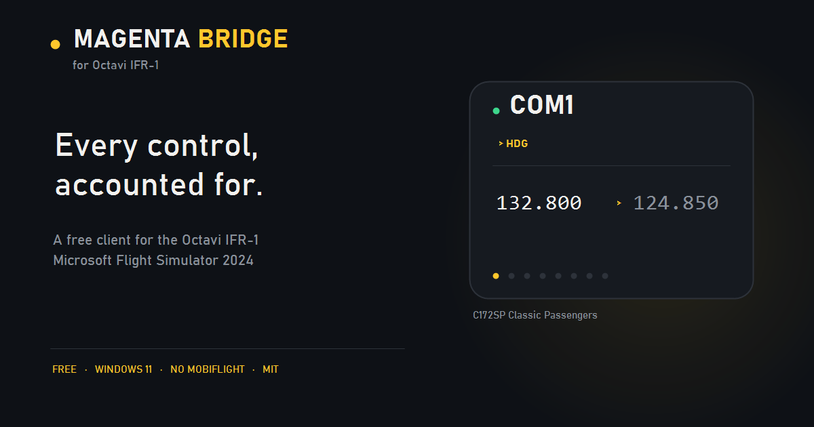
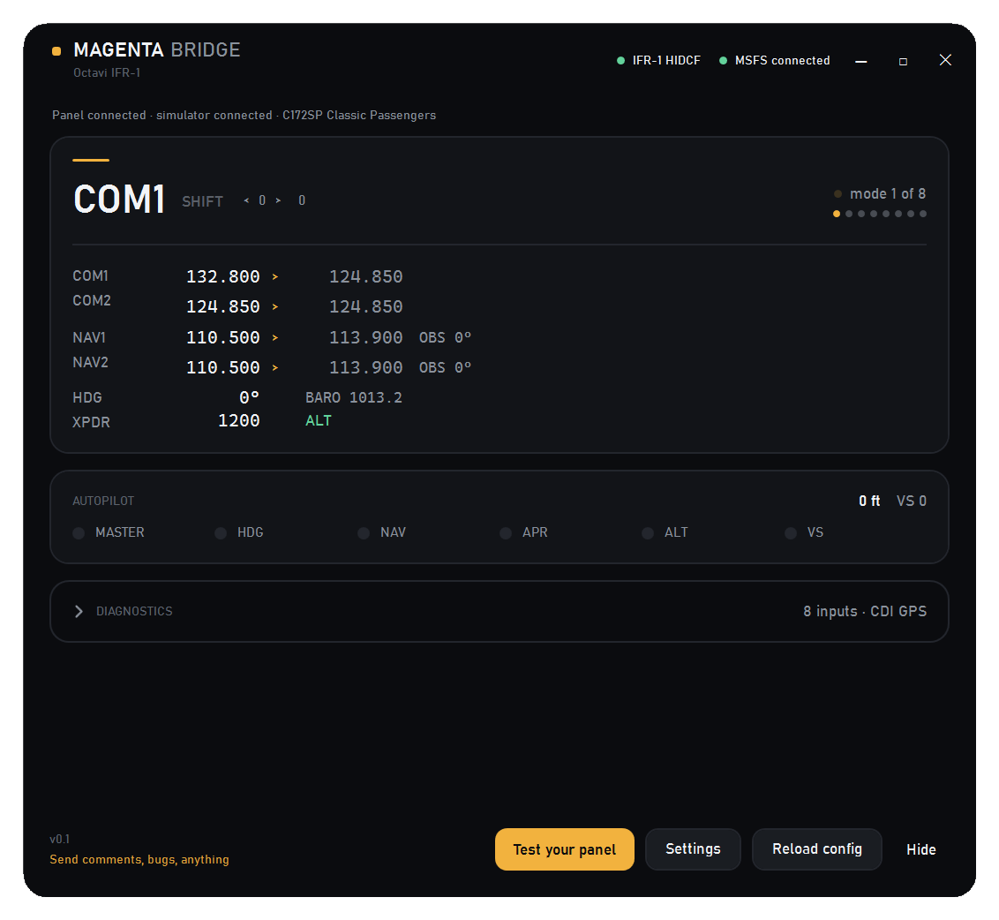
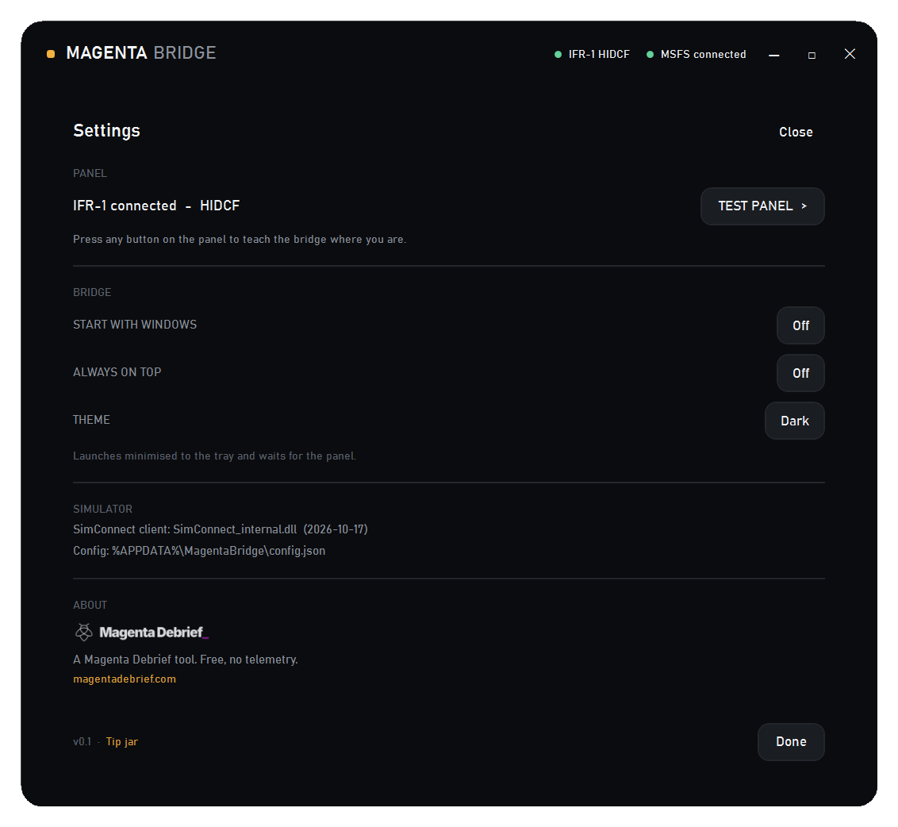
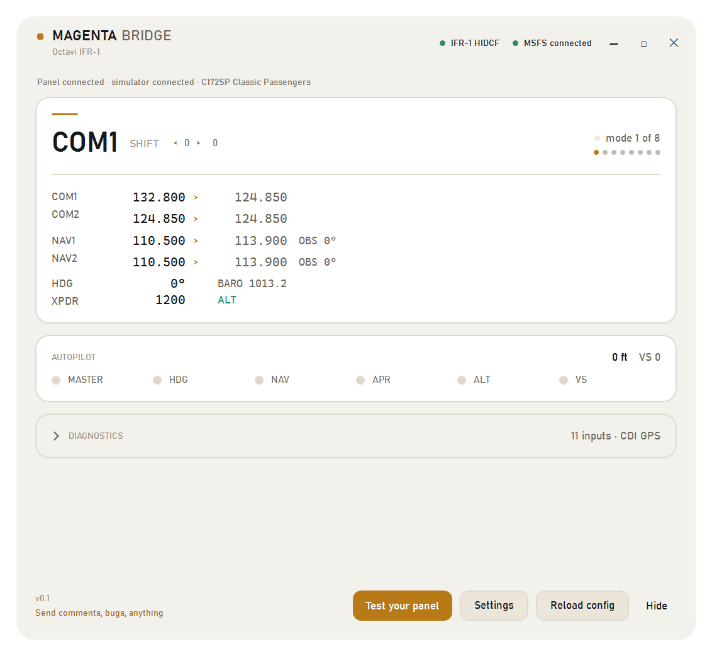

# Magenta Bridge for Octavi IFR-1

**Magenta Bridge** is a free, open-source Windows client for the **Octavi IFR-1**
panel, written from scratch for Microsoft Flight Simulator 2024. It talks to the panel directly and does **not** require
MobiFlight.

It is an independent alternative to the plug-in Octavi ships with the IFR-1 — not a
replacement for it, and not affiliated with or endorsed by Octavi.



**Download:** [latest release](https://github.com/flyingsotong/magenta-bridge-octavi-ifr1/releases/latest)
— Windows 11, self-contained, no installer and no .NET runtime required.

Screenshots, the FAQ and the full comparison live at
[magentadebrief.com/magenta-bridge](https://magentadebrief.com/magenta-bridge/). The panel itself
was reviewed on Magenta Debrief: [Octavi IFR-1 review](https://magentadebrief.com/octavi-ifr-1-review-a-premium-radio-panel-with-real-world-compromises-2026/).

Magenta Bridge is a family of per-device clients. This one is for the Octavi IFR-1; each
product installs alongside the others, with its own settings folder and its own entry in the
taskbar, so they never collide.

I bought the panel, liked the hardware, and wanted to build on it. This is that.

## Status: v0.1.0

Working and verified against live MSFS 2024 and a physical IFR-1. Everything the simulator
exposes to a SimConnect client is implemented. The few controls that need more than that are
documented below, with the reason, so nobody has to discover them the hard way.

## Requirements

- Windows 11 (Windows 10 may work; untested)
- Microsoft Flight Simulator 2024
- An Octavi IFR-1 (VID `04D8`, PID `E6D6`)

The download is self-contained — no .NET runtime installation needed.

## Run it

1. Close Octavi's own plug-in if it is running (see *Two programs, one panel*).
2. Start MSFS and load a flight.
3. Run `MagentaBridge-OctaviIFR1.exe`.

The window opens and a tray icon appears. Closing the window quits; **Hide** sends it to the
tray. Everything relevant — which panel is connected, whether the sim is running, what the
radios are doing — is on the main screen.

## What this does that the official plug-in doesn't

Being a replacement isn't a feature, so here is what is actually different.

| | Octavi's plug-in | This bridge |
|---|---|---|
| **NAV1 / NAV2 standby tuning** | The knob re-sends the frequency the sim just reported, so the value cannot move | Accumulates the pending frequency locally, so every detent changes it |
| **Transponder mode** (OFF/SBY/TST/ON/ALT) | Not in the client | Shift + knob cycles it, clamped at both ends like the real selector |
| **Seeing what it's doing** | No window of its own | Live radio stack, AP lamps, mode, dial positions |
| **Proving the panel works** | — | *Test your panel* walks you through every control and ticks them off |
| **When something can't work** | No error reporting | Says why, in the window and the log (VS ignored by this aircraft, CDI on GPS, panel not answering) |
| **Two clients competing** | Controls stop responding | Detects Octavi's plug-in and offers to close it |
| **Windows 11** | Fixed-size bitmap UI | Per-monitor DPI, dark and light palettes, custom chrome |
| **Remapping** | Fixed | JSON config: per-mode bindings, device selected by serial |
| **Long knob turns** | One click, one step | Accelerates with turn speed |
| **MobiFlight** | Required for FMS | Not required at all |
| **Licence / telemetry** | Closed, unknown | MIT, no telemetry |

**What the official plug-in still does better:** if you already run MobiFlight, its FMS support
reaches the GNS530/430 knobs and the OBS/MSG/FPL/VNAV/PROC softkeys. This bridge cannot, for
the reason below. That is a real advantage of their design, and worth knowing before you
switch.

## What works



| Mode | Dial | Shift |
|---|---|---|
| COM1 / COM2 | standby frequency, swap | **HDG** (10° / 1°), **BARO** |
| NAV1 / NAV2 | standby frequency | **CRS1 / CRS2** |
| AP | target altitude (100 ft) | — |
| XPDR | squawk (2 digits per knob), IDENT | **mode** OFF / SBY / TST / ON / ALT |

Also: all six AP buttons, AP master, encoder acceleration, a guided **Test your panel** check,
dark and light themes, always-on-top, start with Windows, a live radio-stack readout, and the name of the aircraft you are actually flying.

## Two programs, one panel

The IFR-1 is a single HID device and cannot be shared. If Octavi's plug-in is running, the
bridge receives nothing — the window looks connected and controls do nothing.

The app detects that and offers a **Close Octavi plug-in** button. Nothing is closed without
you pressing it. Use one client or the other, not both.

## What does not work, and why

**Vertical speed on some aircraft.** The increment events are correct and the simulator
accepts them, but the C172's autopilot ignores remote VS by design; use its own UP/DN
buttons. The app detects this and says so.

**The mode at launch.** The panel only reports on change, and although it answers
`HidD_GetInputReport` it returns an all-zero report rather than its real state (verified with
the panel in FMS1). Until you touch the panel the window shows `press any button`, then
tracks it accurately.

**GNS530/430 rotary knobs and five softkeys** (OBS, MSG, FPL, VNAV, PROC). These are exposed
only as MSFS *input events*, and `SimConnect_SetInputEvent` does not drive them — which is
why the IFR-1 manual points to MobiFlight's WASM module for FMS support. Reaching them needs
code running inside the simulator that executes the gauge's `>H:` calculator events, i.e. a
WASM module. That is a scope boundary we chose, not an oversight. The FMS **CDI** button
does work, via `TOGGLE_GPS_DRIVES_NAV1`.

## Settings



Panel status and the guided test, Start with Windows, Always on top, Theme, the resolved
SimConnect client, and the About/Magenta details. `Esc` closes it and returns to the main
view.

Light theme is a full second palette, not an inverted filter:



## Troubleshooting

| Symptom | Cause |
|---|---|
| Controls do nothing, no input counted | Octavi's plug-in is running and holds the panel. Use **Close Octavi plug-in**. |
| `press any button` at launch | Expected; the device does not answer a state query. Touch any control. |
| "Waiting for the panel. Check the USB cable." | The device is not enumerated. Reconnect it. |
| Simulator not detected | Start MSFS; the app reconnects on its own. |

Logs live in `%LOCALAPPDATA%\MagentaBridge\OctaviIFR1\logs\`. Diagnostics in the app shows the tail;
the file holds the full rotating history.

## Build from source

```
dotnet build -c Release
dotnet publish -c Release -r win-x64 --self-contained true -o dist
```

Requires the .NET 8 SDK. There are no third-party package references: the whole app is the
base class library plus Win32/SimConnect interop.

`--replay <path>` runs the 36 self-checking decode assertions and writes the results; they
cover every mapping, the shift latch, NAV accumulation, transponder clamping and the
AP altitude/VS split.

## License

MIT. See [LICENSE](LICENSE). Use it, fork it, ship it, ignore it — no permission needed.

No Octavi code, binaries or artwork are included. The HID protocol was recovered by
observation and reverse engineering for interoperability.

## Feedback

Bugs and comments: <alan@magentadebrief.com>. A Magenta Debrief tool — free, no telemetry.
